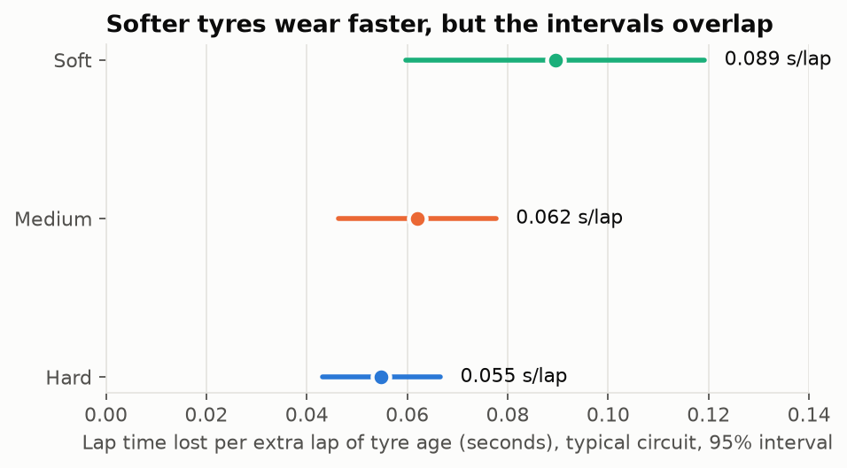
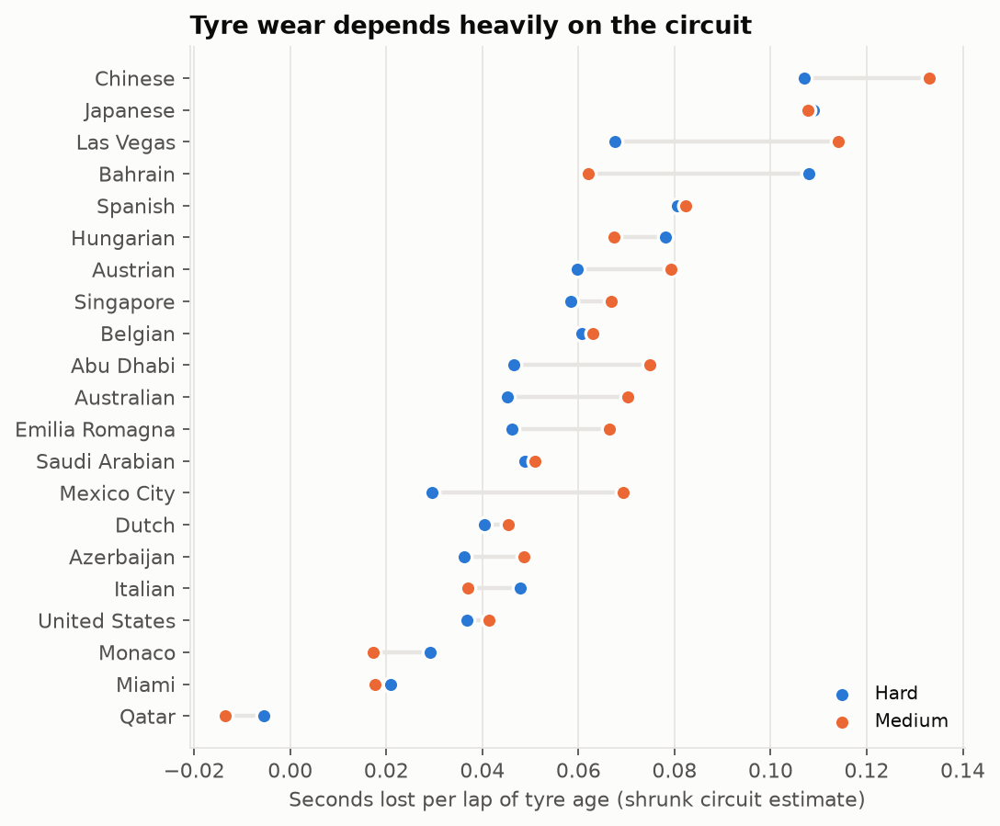
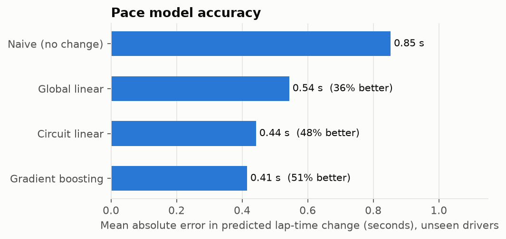
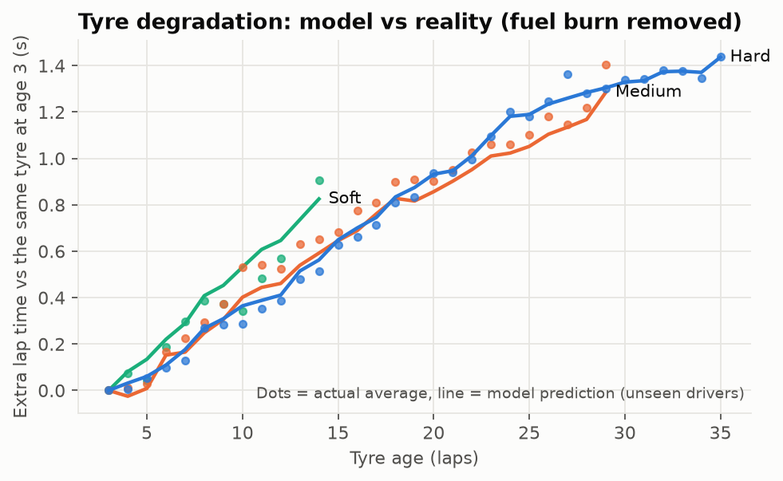
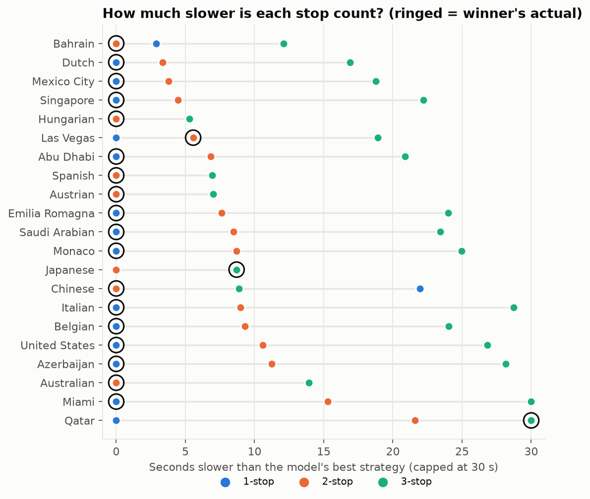
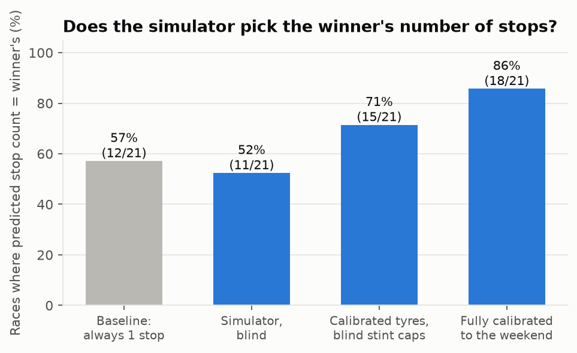
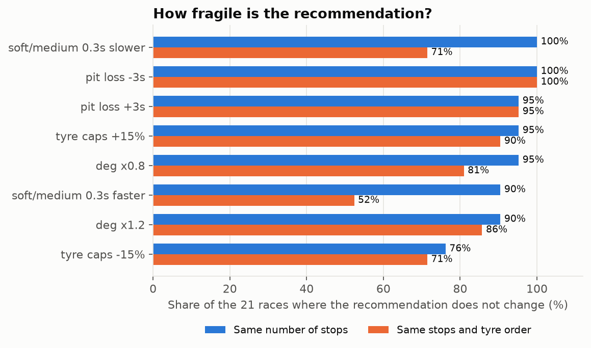
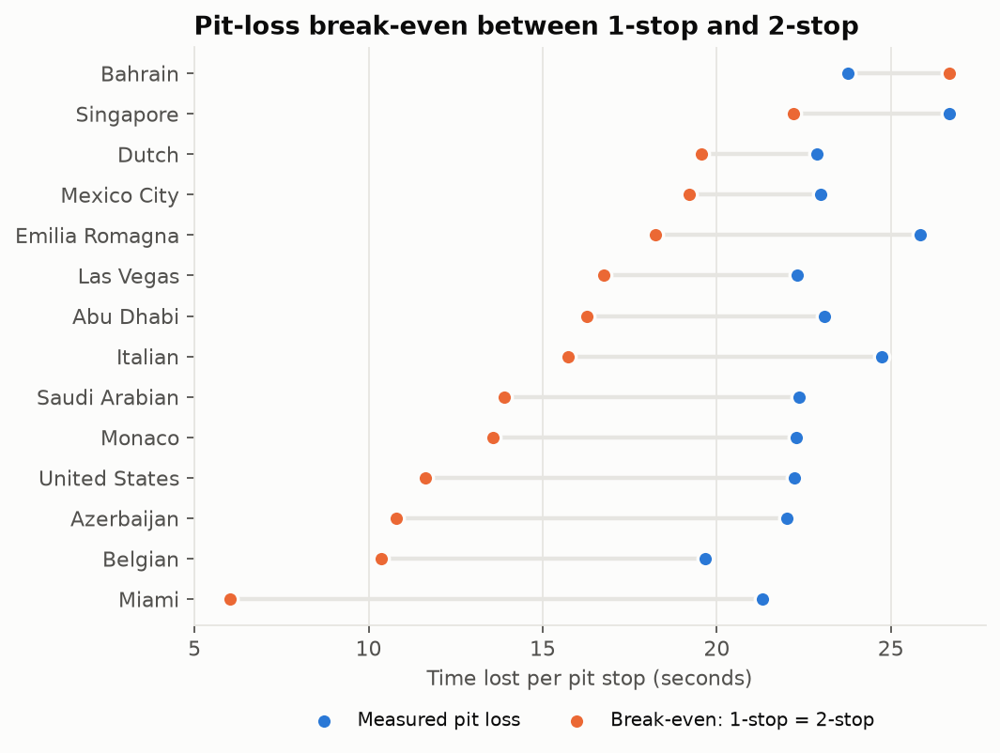
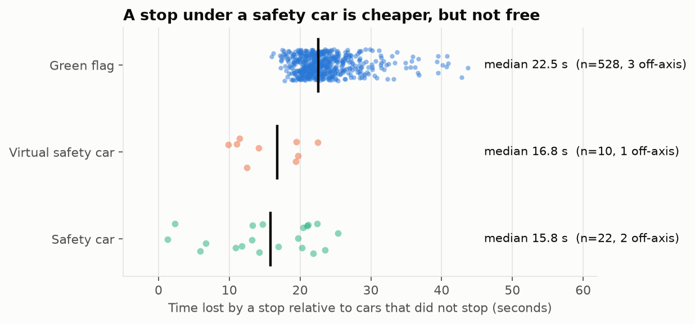
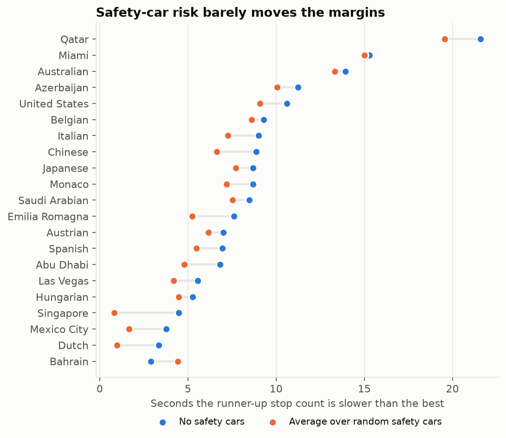

# Formula 1 Race Strategy & Simulation Suite (2024 season)

Can lap-time data tell you how many times a driver should pit, and when? This project takes every race lap of the 2024 Formula 1 season, measures how tyres wear and what a pit stop costs, and uses that to find the fastest race strategy for each circuit. It then checks the answer against what race winners actually did, including where it fails.

**Data:** 26,604 race laps from 24 Grands Prix (via [FastF1](https://github.com/theOehrly/Fast-F1)). After removing safety-car laps, pit laps, wet laps and outliers: 20,340 clean laps across 21 dry races.

## Key results

| Question | Answer |
|---|---|
| How fast do tyres wear? | Typical circuit: **soft 0.089, medium 0.062, hard 0.055 seconds lost per lap of tyre age**. Circuits differ a lot: under 0.03 s/lap at Qatar, Miami and Monaco, over 0.10 s/lap at China and Japan. |
| How much does a pit stop cost? | **22.5 s median** (528 green-flag stops), ranging from 19.7 s to 26.7 s by circuit. |
| Can a model predict how lap times change during a race? | Yes, on drivers it has never seen: error falls from **0.85 s to 0.41 s per lap (51% better)** with gradient boosting, and to 0.44 s (48% better) with a simple circuit-specific linear model. |
| Does the strategy simulator pick the winner's number of stops? | **18 of 21 races (86%)** when tyre data comes from that weekend, against 12 of 21 (57%) for the baseline "always 1 stop". With no knowledge of the circuit it does **not** beat the baseline (11 of 21). See the validation section. |
| How much cheaper is a stop under a safety car? | **About 30% cheaper under a safety car (15.8 s vs 22.5 s) and 26% under a virtual safety car (16.8 s)**, from 32 stops. The 90% interval on the saving is wide (9% to 42% for the safety car), because there are few such stops. |
| Does adding safety-car risk change the recommended number of stops? | **No.** Averaged over random safety-car scenarios, the recommended stop count changed in **0 of 21 races**, and matching winners stayed at 18 of 21. It does narrow the gap to the runner-up strategy in 20 of 21 races (median 1.5 s, at most 3.7 s). |
| How robust is the recommendation? | The recommended number of stops survives plausible input errors in **93%** of cases. The recommended tyre order is much less stable (80% overall, 52% if softs/mediums are 0.3 s faster than estimated). |

## Charts

**Tyre wear by compound and circuit**




**Does the model predict lap-time change?** Degradation is close to linear, so a linear model is a reasonable fit.




**Strategy simulator**






**Safety cars**




All numbers behind the charts are in `outputs/*.csv`, including the recommended strategy for every race (`optimal_strategies.csv`).

## How it works

1. **Clean the laps** (`src/data.py`). Keep only representative racing laps: green flag, dry, not lap 1, not an in-lap or out-lap, not far slower than that driver's normal pace. Three wet or mixed races (Britain, Canada, Brazil) are dropped.
2. **Measure tyre wear and fuel burn** (`src/degradation.py`). Each driver in each race gets their own baseline lap time (this removes car, driver and circuit speed). The model then learns only from changes within one driver's race: how lap time moves as the tyres age and the car gets lighter. Circuit-specific estimates are noisy, so they are combined with a random-effects (empirical Bayes) method: a precisely measured circuit keeps its own value, a noisy one is pulled towards the typical value.
3. **Check lap-time prediction** (`src/pace_models.py`). Four models are compared with 5-fold cross-validation grouped by driver, so every test driver is unseen: naive, global linear, circuit-specific linear and gradient boosting.
4. **Measure pit-stop cost** (`src/pit_loss.py`). Pit loss is the in-lap plus out-lap time minus twice the driver's normal pace, for green-flag stops only (safety-car stops are cheap and would bias the result).
5. **Simulate strategies** (`src/simulator.py`). For each circuit, dynamic programming finds the fastest combination of tyre compounds and pit laps for 1, 2 and 3 stops. Rules: at least two different dry compounds, stints of at least 5 laps, and no stint longer than the longest observed on that compound at that circuit (the model does not extrapolate wear beyond real data). The optimiser is tested against an exhaustive brute-force search (`tests/test_core.py`).
6. **Validate and stress-test** (`src/validation.py`).
7. **Add safety-car risk with Monte Carlo** (`src/safety_car.py`, `src/sc_validation.py`). A lap counts as neutralised when at least half the field carries the safety-car or virtual-safety-car flag. From the 21 dry races the model fits how often these happen (0.43 safety cars and 0.33 virtual safety cars per race), how long they last, and how much cheaper a stop is under them (measured against cars that did not stop on the same laps, so the slow laps themselves cancel out). It then draws 1,500 random races, lets a team move each stop by up to 10 laps to catch a neutralisation, and scores each strategy by its **average** race time. Three versions are compared with the winner's stop count: the original (no safety cars), a fair **forecast** (rates fitted on the other 20 races only) and a **hindsight** version that is given the race's real safety cars. The hindsight version is not a forecast; it asks whether knowing the safety cars would explain what winners did.

## Validation: what worked and what did not

The test is whether the simulator's best number of stops equals the race winner's.

| Test | Correct |
|---|---|
| Baseline: always predict 1 stop | 12 / 21 |
| Simulator, **blind**: parameters from the other 20 circuits only | 11 / 21 |
| Simulator, that weekend's tyre data but stint limits from other circuits | 15 / 21 |
| Simulator, fully calibrated to that weekend | 18 / 21 |

What this says:

- A generic model with no circuit knowledge is no better than guessing "1 stop". Tyre behaviour differs too much between circuits for averages to work.
- Knowing how the tyres behave at that weekend's circuit is what makes the model useful, which matches how teams use practice running.
- The 18 / 21 figure is optimistic because the stint-length limits come from stints teams actually ran. The 15 / 21 row removes that, and is the fairer number.
- Only 21 races are tested, so these percentages are rough.

The three misses: Japan (model 2 stops, winner 3), Las Vegas (model 1, winner 2) and Qatar (model 1, winner 3). Qatar had the most laps under safety car, VSC or red flag of any race (22%), so I first suspected the model's blind spot for cheap stops under neutralisation. **The safety-car extension below tests that and rejects it:** even when the model is handed Qatar's real safety cars in advance, it still recommends one stop. I have no confirmed explanation for any of the three misses.

### Does safety-car risk change the answer?

| Version | Correct |
|---|---|
| Original simulator (no safety cars) | 18 / 21 |
| Safety-car aware, forecast (rates from the other 20 races) | 18 / 21 |
| Safety-car aware, hindsight (the race's real safety cars known) | 18 / 21 |

The recommendation was unchanged in all 21 races and the same three races were missed in every version. Safety-car risk does make the runner-up strategy look less bad: the average gap to it shrinks in 20 of 21 races (median 1.5 s), for example Emilia Romagna from 7.6 s to 5.2 s and Singapore from 4.5 s to 0.8 s, so a few races become close calls rather than clear ones. Bahrain is the one race where the gap grows (2.9 s to 4.4 s). Sensitivity to the weakest assumptions:

| Assumption changed | Races where the stop count changes | Matches winner |
|---|---|---|
| As fitted | 0 | 18 / 21 |
| Safety cars and VSCs twice as frequent | 3 | 15 / 21 |
| Stop saving 50% larger | 2 | 16 / 21 |
| Half as frequent, saving 50% smaller, no reaction, wider reaction | 0 | 18 / 21 |

Only when the assumptions are pushed towards more or bigger safety-car benefit do recommendations change, and then they match winners worse, not better. The honest reading is that at these circuits, with this data, safety cars are not what separates the model from what winners did.

## Limitations

- **No traffic or overtaking.** Real strategy is often decided by track position. The core model finds the fastest strategy on an empty track.
- **Safety-car model is deliberately simple and thinly measured.** It rests on 16 episodes and 32 stops from one season. Arrival rates are pooled across circuits (Monaco and Baku are not treated as riskier than Bahrain), start laps are uniform, tyres do not wear during neutralised laps, a team can move a stop by at most 10 laps, and bunching up of the field and the position lost or gained by pitting under a safety car are not modelled. Red-flag periods are counted as safety cars.
- **Compound pace differences are poorly measured.** How much faster a fresh soft is than a medium or hard could not be pinned down well from race laps, and the raw estimates were sometimes in the wrong order. They are forced into the physical order soft ≤ medium ≤ hard, and the **tyre order the simulator recommends should be treated as low confidence**. The number of stops and the pit-window timing are more reliable.
- **Wear is modelled as linear** with no sudden "cliff". Because teams pit before the cliff, the data cannot show one; the stint-length limit stands in for it. Tightening that limit by 15% changes the recommended stop count in 24% of races, which makes it the most influential assumption.
- **Survivorship in old tyres.** Drivers pit when their tyres degrade quickly, so the oldest tyre ages in the data come from slower-wearing runs, which probably understates real wear at high age.
- **"Fuel" effect includes track evolution.** The fitted -0.063 s/lap combines the car getting lighter and the track rubbering in.
- **One season, one race per circuit.** Circuit estimates come from a single race each.
- Wet and mixed races are excluded entirely.

## Next steps

Add more seasons for stronger circuit estimates (this would also allow circuit-specific safety-car rates); investigate why Japan, Las Vegas and Qatar are missed, starting with the winners' actual stint lengths and any tyre rules in force; add traffic and undercut/overcut effects; allow a tyre-cliff term; fit driver-specific tyre management.

## Run it yourself

```bash
pip install -r requirements.txt

# 1. (optional) re-download the data - takes 10-20 minutes, needs internet.
#    This ONLY saves the raw laps to laps_2024.csv. It does not run any analysis.
python download_laps.py 2024

# 2. run the whole analysis (about 2.5 minutes); writes the tables to outputs/ and the charts to outputs/figures/
python run_all.py
python run_all.py --quick     # about 1 minute: skips the slowest safety-car sensitivity runs and uses fewer random races

# 3. run the correctness tests
python tests/test_core.py
```

`data/laps_2024.csv` is included, so step 2 works without step 1. All results and charts come from step 2.

## Project layout

```
download_laps.py     downloads race laps with FastF1
run_all.py           runs everything end to end
src/data.py          lap cleaning
src/degradation.py   tyre wear + fuel model
src/pace_models.py   lap-time prediction, cross-validated
src/pit_loss.py      pit-stop cost
src/params.py        simulator inputs, actual strategies
src/simulator.py     strategy optimiser (dynamic programming)
src/validation.py    validation + sensitivity analysis
src/safety_car.py    safety-car / VSC fitting and Monte Carlo scoring
src/sc_validation.py safety-car forecast vs hindsight vs winners, sensitivity
src/figures.py       charts
tests/test_core.py   optimiser vs brute force, model recovery, safety-car consistency tests
data/                laps_2024.csv
outputs/             result tables and charts
```

## Data and credit

Lap data comes from the official Formula 1 live-timing feed via the open-source [FastF1](https://github.com/theOehrly/Fast-F1) library. This is an independent analysis project and is not affiliated with or endorsed by Formula 1 or any team.
